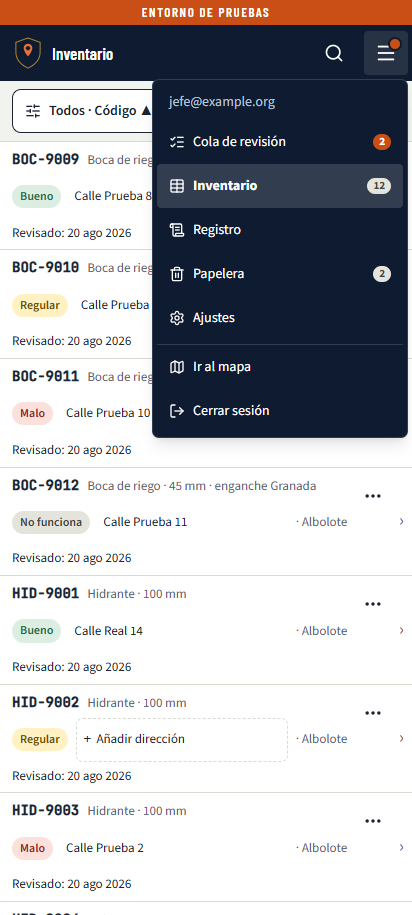
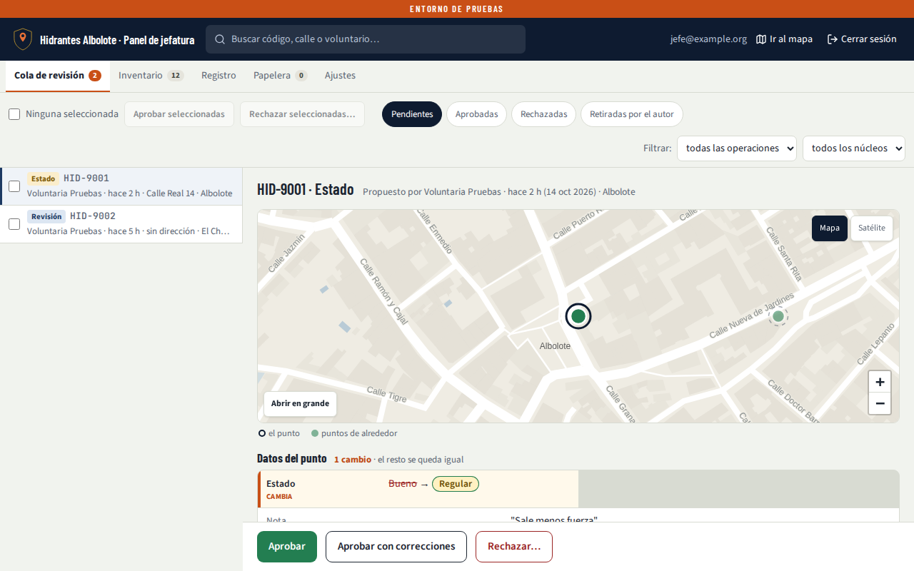
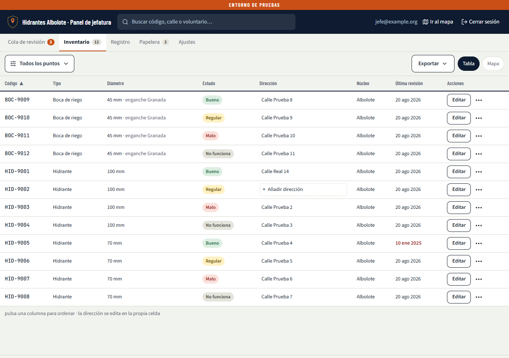
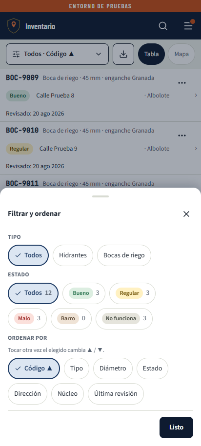
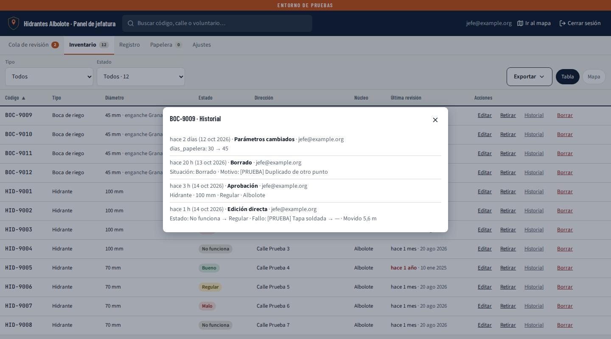
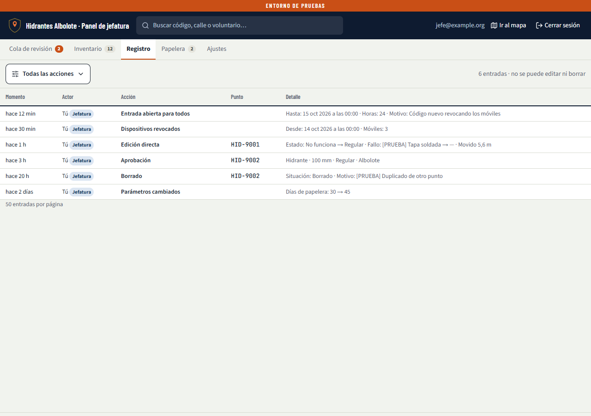
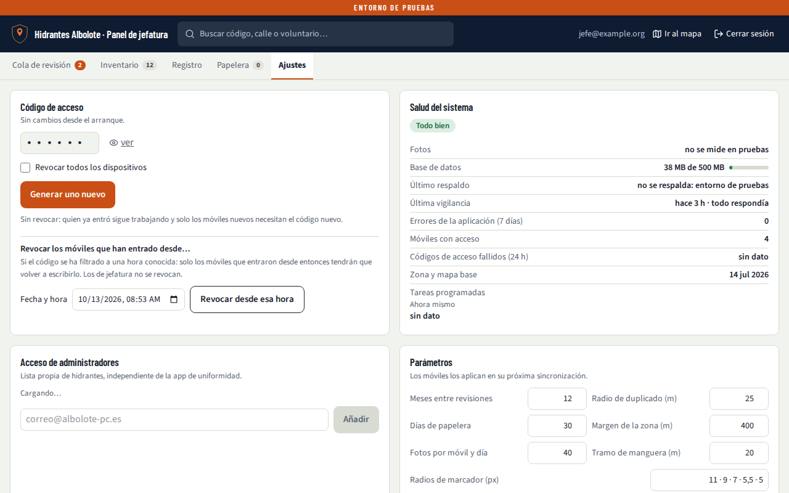

# 13 · Manual de jefatura — Mapa de hidrantes

| | |
|---|---|
| **Estado** | **Borrador, se revisa tras el piloto** (DEC-041, `docs/31` RV-139). |
| **Versión** | 0.9 — 16 de octubre de 2026 (`docs/39` RV-525): §4 y §5, cómo se ve en el móvil (el detalle a pantalla completa, «Corregir», «Rechazar seleccionadas…», Exportar como icono); §5, la revisión caducada es la fecha en rojo; §8, Mantenimiento en staging. 0.8 — 16 de octubre de 2026 (`docs/39` RV-524): §10, la app del piloto se llama «Hidrantes test». 0.7 — 16 de octubre de 2026 (`docs/39` RV-523): §5, las fotos en Editar y el mapa que abre Editar. 0.6 — 16 de octubre de 2026 (`docs/39` RV-517): §8 y §11, el aviso de las tareas automáticas paradas. 0.5 — 16 de octubre de 2026 (`docs/38` RV-511): el panel en el móvil y la tableta: §3, las pestañas en ☰, la lupa y el punto naranja; §4, el botón de filtros y la barra de lote solo con algo marcado; §5, filtrar y ordenar desde un botón, tocar la fila abre Editar y «⋯» lleva lo demás, «＋ Añadir dirección»; §6, el filtro del Registro y «Tú»; §7, «Purgar lo caducado…» en rojo; §8, el orden de las tarjetas y Administradores con su etiqueta y «⋯». 0.4 — 15 de octubre de 2026 (`docs/37` RV-496): §8, activar los avisos técnicos antes del piloto, porque vienen apagados (DEC-202); §10, la rutina de antes del piloto (entrar en el panel, volver a entrar en los demás dispositivos, DEC-206, y activar los avisos). El día del lanzamiento (RV-491) y `OTRA_CUENTA` (RV-493) ya estaban en §8 y §2. 0.3 — 14 de octubre de 2026 (`docs/36` RV-480): tras unir la cuenta de jefatura hay que volver a entrar una vez en los otros dispositivos, qué quiere decir «Esta cuenta tiene otra identidad unida» y el aviso de una cuenta desunida (DEC-206). 0.2 — 13 de octubre de 2026 (`docs/35`), aprobada por el desarrollador al pedir el cambio: el código nuevo revocando ya no abre la entrada solo; revocar los móviles que han entrado desde una hora (DEC-201); quitar el acceso a un administrador pide confirmación (RV-431) y cada administrador queda unido a su cuenta de Google al entrar (DEC-197). 0.1 — 7 de octubre de 2026. Primer borrador completo, con el panel de la versión 0.9 (cinco pestañas) y las capturas de `capturas/vistas/`. |
| **Para** | Jefatura y los administradores del panel. |
| **Se apoya en** | 02 (los pasos, FL-20 a FL-38), 01 (las reglas), 11 (datos personales) y 15 (qué hacer si algo falla). Si este manual y esos documentos dicen cosas distintas, mandan ellos, y este manual se corrige. |

Las capturas son de pruebas: llevan la banda naranja **ENTORNO DE PRUEBAS** y datos inventados
(«[PRUEBA]», «Voluntaria Pruebas», `jefe@example.org`). En producción no sale esa banda.

Todo lo que el voluntario hace en el móvil está en el manual del voluntario (14). Este manual
cuenta lo que es solo de jefatura.

---

## 1. Qué hace jefatura

- **Revisar** lo que proponen los voluntarios: nada cambia en el mapa de todos sin vuestra
  aprobación.
- **Mantener el inventario**: editar, retirar o borrar puntos directamente.
- **Dar acceso**: el código de acceso del grupo y la lista de administradores.
- **Vigilar** que el sistema está sano (Salud del sistema) y avisar al responsable técnico si no.

## 2. Entrar

- **En el ordenador:** abre la app → *¿Eres de jefatura? Entrar con Google* (o la dirección del
  panel) → tu cuenta de Google. Si tu correo no está en la lista de administradores, verás «No
  autorizado».
- **En el móvil:** entra igual, con Google. Ves el mapa de los voluntarios con la etiqueta
  **Jefatura** arriba. Al tocar *Jefatura* (o *Ajustes → Panel de jefatura*) se abre el panel; *Ir
  al mapa* o «atrás» te devuelven.
- **Cerrar sesión**, arriba a la derecha.

**La primera vez que entras en el panel** (o la primera tras devolverte el acceso), tu fila de
administrador queda unida a tu cuenta de Google (DEC-197). Al unirla se cierran las sesiones que esa
cuenta tenga abiertas en tus otros dispositivos (DEC-206): en el otro ordenador o en el móvil tendrás
que **volver a entrar una vez**. Si usas el mismo usuario en la app de uniformidad, también allí. Después
ya no vuelve a pasar.

**Si sale «No autorizado» con este texto:** «Esta cuenta tiene otra identidad unida. Pide a otro
administrador que te quite y te devuelva el acceso, y entra con una cuenta de Google propia.» Quiere
decir que la cuenta con la que has entrado no es solo tuya: tiene unida otra forma de entrar (otra
cuenta u otro proveedor) con un correo distinto o sin verificar, y una cuenta así no se une a jefatura
(para el responsable técnico es la respuesta `CUENTA_MEZCLADA`, que queda anotada en *Errores de la
aplicación* de Salud del sistema).
Entra con una cuenta de Google que solo uses tú y pide a otro administrador que te quite el acceso y
te lo devuelva en *Ajustes → Acceso de administradores*. Si no sabes de dónde sale esa otra identidad,
avisa al responsable técnico (15 §5.5).

**Si sale «No autorizado» con «Este correo de jefatura ya está unido a otra cuenta de Google»:** tu correo
de jefatura quedó unido la primera vez a otra cuenta de Google (`OTRA_CUENTA`). Entra con esa cuenta. Si
ya no la tienes o no es tuya, pide a otro administrador que te quite el acceso y te lo devuelva en
*Ajustes → Acceso de administradores*: eso deshace la unión, y la próxima vez que entres se une a la cuenta
con la que entres. Si no sabes de qué cuenta se trata, 15 §5.5.

Desde el móvil, como jefatura, cualquier operación sobre un punto **se aplica al momento**: el botón
dice *Aplicar ahora* y el cambio no pasa por la cola. Queda en el Registro como acción de
administrador.

## 3. El panel

Cinco pestañas: **Cola de revisión**, **Inventario**, **Registro**, **Papelera** y **Ajustes**. Cola de
revisión, Inventario y Papelera llevan al lado cuántas cosas tienen. La búsqueda de arriba encuentra por código, calle
o voluntario.

**En el móvil** (menos de 768 px de ancho) no hay fila de pestañas: la cabecera dice en qué pestaña estás, y las
pestañas, con sus números, están en el menú **☰** de arriba a la derecha. Si hay propuestas pendientes y estás en otra
pestaña, el ☰ lleva un **punto naranja**. La búsqueda está detrás de la **lupa**; la ✕ la cierra y borra lo escrito.

En la tableta y el ordenador las pestañas siguen arriba. Las listas se leen igual en todos los tamaños: en el móvil y
la tableta, una fila de tres líneas por elemento; en el ordenador (desde 1.100 px), la tabla.

## 4. Cola de revisión

A la izquierda, las propuestas; a la derecha, la elegida. **En el móvil y la tableta**, tocar una propuesta abre su
detalle a pantalla completa, con **‹** arriba para volver a la lista:

- el **mapa** con el punto y los de alrededor (*Abrir en grande*, *Mapa* / *Satélite*);
- **Datos del punto**: todos los campos, con lo que cambia marcado («Bueno → Regular»);
- las **fotos** (Conexión y Sitio) y la dirección deducida, que se puede corregir ahí mismo.

**Decidir:**

- **Aprobar.**
- **Aprobar con correcciones** (en el móvil, **Corregir**): cambias lo que haga falta y *Guardar y aprobar*. Un hidrante con
  «otra medida» de diámetro hay que dejarlo en 70 o 100 antes de aprobarlo; una boca de riego se
  aprueba tal cual.
- **Rechazar…:** el motivo es obligatorio. El voluntario lo verá.
- **Fusionar** (solo si sale como posible duplicado, a menos de 25 m de otro): eliges campo a campo
  qué se queda. No se crea un punto nuevo.
- Si el punto cambió después de la propuesta, el botón pasa a *Confirmar y aprobar* y el panel lo
  explica.

**En bloque:** marca las casillas (o *todas*) y aparece la barra de lote con **Aprobar seleccionadas**: abajo en el
móvil y la tableta, arriba en el ordenador. Sin nada marcado no hay barra. Lo típico: filtrar por *revisiones* («sigue
igual») y aprobarlas de golpe. El panel dice cuántas se aprobaron y cuáles se quedaron fuera, y por qué. **Rechazar
seleccionadas…** pide un motivo común, el que verán los autores de todas.

**Filtros:** el botón de filtros de arriba (dice lo que está elegido, por ejemplo «Pendientes · Alta») abre una hoja
con **Estado** (*Pendientes*, *Aprobadas*, *Rechazadas*, *Retiradas por el autor*: las ya decididas, en solo lectura,
con quién y por qué), **Operación** y **Núcleo**. *Quitar filtros* lo deja todo como al principio; *Listo* cierra.

## 5. Inventario

- **Filtrar y ordenar:** el botón de arriba abre una hoja con **Tipo**, **Estado** (con cuántos puntos hay de cada uno)
  y, en el móvil y la tableta, **Ordenar por** (tocar otra vez el elegido cambia ▲ / ▼). En el ordenador se ordena
  tocando el título de cada columna. La fecha de la última revisión **en rojo** es lo caducado: lo que conviene mandar a
  revisar.

  

- **Tabla** o **Mapa**, a la derecha. En el mapa, tocar un punto abre su *Editar*.
- **Exportar ▾** (en el móvil, un botón con el icono de descarga): Excel, CSV o GeoJSON, con los filtros aplicados. El archivo se genera en tu
  navegador. Para bomberos o el ayuntamiento. Queda en el Registro. La cuarta opción,
  **Inventario completo (JSON)**, descarga todo sin filtros, como copia de consulta.

**Sobre cada punto:** en el móvil y la tableta, **tocar la fila abre Editar**, y el **«⋯»** de la fila lleva
*Historial*, *Retirar* y *Borrar*. En el ordenador, cada fila tiene **Editar** y **«⋯»** con lo mismo.

- **Editar:** se abre al lado (a pantalla completa en el móvil), con **las fotos del punto** arriba (conexión y
  sitio; tócalas para verlas en grande; aquí no se cambian), el mapa y lo que cambias
  marcado. Puedes mover el punto y cambiar diámetro, enganche, estado, fallo, dirección y
  descripción; el tipo no. *Guardar cambios* se aplica al momento.
- **Retirar:** el punto existió y ya no está (obras, asfaltado). Pide motivo y se conserva su
  historia.
- **Historial:** todo lo que ha pasado con ese punto, dicho con palabras.

  

- **Borrar:** el punto nunca debió existir (un error, un duplicado). Pide motivo y va a la
  **Papelera**.
- **Dirección:** se escribe en la propia celda, sin abrir Editar. Si falta, la celda dice **«＋ Añadir dirección»**.

**Retirar o borrar:** si el hidrante estaba y lo quitaron, *Retirar*. Si nunca existió, *Borrar*.

## 6. Registro

Todo lo que se ha hecho: cuándo, quién, qué acción, sobre qué punto y qué cambió. El botón de filtros de arriba
(«Todas las acciones») deja elegir una acción, por ejemplo *Borrado*. Lo que hiciste tú dice **«Tú»** en vez de tu
correo. **No se puede editar ni borrar.** Sirve para responder a «¿quién cambió esto y cuándo?».

## 7. Papelera

Los puntos borrados se guardan los días que diga *Ajustes → Parámetros → Días de papelera* (30 por
defecto). **Restaurar** los devuelve al mapa; si a uno le queda un día, sale en rojo. Pasado ese plazo se purgan
solos; **Purgar lo caducado…**, el botón rojo de arriba, apartado de los *Restaurar*, lo hace ya, y **no se puede
deshacer**.

## 8. Ajustes

Las tarjetas van en este orden: Código de acceso, Acceso de administradores, Salud del sistema, Avisos para jefatura,
Parámetros, Núcleos, Mantenimiento, Código QR del enlace y Novedades. En el móvil, una debajo de otra; en el ordenador,
en dos o tres columnas.

### Código de acceso

El código de seis cifras con el que entran los voluntarios.

1. Decide si marcas **Revocar todos los dispositivos**:
   - **sin marcar**: quien ya entró sigue trabajando; solo los móviles nuevos necesitan el código
     nuevo;
   - **marcado**: todos vuelven a teclearlo. Es lo que se usa **si el código se ha filtrado**. La
     entrada **no** se abre sola: si quieres que todos puedan volver a entrar a la vez, marca también
     **Abrir la entrada 24 h para que todos puedan volver a entrar a la vez** (abajo). Si el código se
     ha filtrado, mejor no: ábrela después, cuando el nuevo ya esté repartido.
2. **Generar uno nuevo** → **Generar y poner en vigor**.
3. Pásalo al grupo por el canal habitual. Nunca en un sitio público.

#### La entrada (el día del lanzamiento)

Para que un código filtrado no sirva para mucho, la app deja entrar a pocos móviles a la vez: 20 al
día desde una misma wifi y 40 por hora entre todos. Cuando entra todo el grupo de golpe (el día del
lanzamiento, en una reunión con la wifi de la sede, o después de cambiar el código revocando),
eso se queda corto.

- **Abrir la entrada para todos (24 h)**, en *Código de acceso*: durante 24 horas entran todos los
  que tengan el código, desde la misma wifi si hace falta. Quien pruebe códigos al azar sigue frenado
  igual.
- Abierta, sale una franja verde con **hasta cuándo** y el botón **Cerrar ahora**. Si no, se cierra
  sola al pasar la hora.
- **El día del lanzamiento: ábrela antes de pasar el código al grupo.** Con la entrada abierta entran
  unas 60 personas por minuto desde la misma wifi; cerrada, unas 10. Si a alguien le sale «Mucha gente
  entrando a la vez», no tiene que hacer nada: la app lo vuelve a intentar sola.
- Si *Salud del sistema* dice que hay **entradas frenadas por el tope**, alguien con el código bueno
  se ha quedado fuera: ábrela desde ahí.
- Abrirla y cerrarla queda en el *Registro*.

#### Revocar los móviles que han entrado desde una hora

Si sospechas que el código se filtró a una hora concreta, no hace falta echar a todos: **Revocar los
móviles que han entrado desde…**, junto al código. Elige la fecha y la hora (por defecto, hace 24
horas; como mucho, 30 días atrás). Antes de confirmar te dice cuántos son. Esos móviles tienen que
volver a teclear el código; los de jefatura nunca se revocan. Queda en el *Registro* con el número
y la hora. Cambia también el código si el que se filtró sigue en vigor.

### Acceso de administradores

Cada administrador sale con su correo (el tuyo, con **«Tú»**), una etiqueta (**Activo**, **Pendiente de su primer
acceso** o **Sin acceso**) y quién lo añadió. Escribe el correo y **Añadir** (hasta que no escribes un correo, el botón
no se puede tocar y lo dice debajo). Para quitar a alguien, **«⋯» → Quitar el acceso…** y confírmalo (si eres tú,
saldrás del panel); para devolverlo, **«⋯» → Devolver el acceso**. Tiene que quedar al menos un administrador con
acceso. Quien acabas de añadir queda unido a su cuenta de Google la primera vez que entra en el panel,
y tendrá que volver a entrar una vez en sus otros dispositivos (apartado 2). No hace falta tocar nada
técnico. La comprobación diaria revisa estas uniones: si una cuenta deja de ser de una sola persona, la
desune y lo dice en la issue de vigilancia (y llega el aviso técnico de la comprobación diaria); quien
sea vuelve a entrar (15 §4).

### Parámetros

Meses entre revisiones, radio de duplicado, días de papelera, margen de la zona, fotos por móvil y
día, tramo de manguera, radios de marcador y los dos topes de entrada («Entradas desde una misma
wifi al día» y «Entradas por hora, entre todos»; para un día puntual es mejor abrir la entrada 24 h
que subirlos). **Guardar cambios**; los móviles los aplican en su
siguiente sincronización. Si no sabes qué hace uno, déjalo como está.

### Núcleos

Los barrios y pueblos de la zona, sacados de OpenStreetMap. Se puede renombrar uno o añadir el que
falte.

### Salud del sistema

Arriba, un resumen: **«Todo bien»** o **«Necesita atención»** con lo que falla (respaldo que falta
o es viejo, vigilancia que no pasa o tiene avisos, fotos o base de datos al 70 % o más, una tarea
programada que falla). Debajo, lo que hay que mirar:

| Fila | Bien | Avisa al responsable técnico si… |
|---|---|---|
| Fotos | lejos de los 800 MB | la barra pasa del 70 % (15 §5.7) |
| Base de datos | lejos de los 400 MB | la barra pasa del 70 % |
| Último respaldo | de esta semana | tiene más de una semana |
| Última vigilancia | «todo respondía» | dice «con avisos» o lleva más de un día sin pasar |
| Errores de la aplicación (7 días) | 0 o pocos | sube de golpe |
| Móviles con acceso | más o menos los del grupo | hay muchos más que voluntarios |
| Códigos de acceso fallidos (24 h) | 0 o pocos | hay muchos: alguien prueba códigos (15 §5.4) |
| Entradas frenadas por el tope (24 h) | 0 | hay alguna: alguien con el código bueno no ha podido entrar. **Abre la entrada 24 h** con el enlace de la fila |
| Zona y mapa base | una fecha | — |

Debajo están las tareas programadas, con su nombre en palabras y cuándo pasaron por última vez, y los móviles que más fotos han pedido en 24 h.

Para descargar el inventario completo (JSON), ve a *Inventario → Exportar → Inventario completo
(JSON)*. Es una copia de consulta; el respaldo de verdad es automático (15).

### Mantenimiento

*Regenerar zona de cobertura*, *Regenerar mapa base*, *Respaldo ahora* y *Purgar fotos huérfanas*.
Se ejecutan fuera de la aplicación y tardan unos minutos; el resultado sale en Salud del sistema y en
el Registro. En el uso normal no hace falta tocarlos. **En staging (la app del piloto)**, *Purgar fotos huérfanas* y
*Respaldo ahora* no se pueden usar (trabajan contra producción) y los otros dos solo quedan pedidos: nadie los lanza
desde staging.

### Avisos para jefatura

Notificaciones en este navegador, apagadas por defecto: **Nuevas propuestas pendientes** (como mucho
una por hora), **Resumen semanal** (los lunes: revisiones caducadas y pendientes antiguas) y **Avisos
técnicos** (si falla la comprobación diaria, el respaldo o una actualización, si las tareas automáticas llevan días
sin hacerse, o si alguien está probando códigos de acceso; como mucho uno de cada tipo al día, el de los códigos uno por hora). Un aviso
técnico lleva a Ajustes: mira Salud del sistema; el responsable técnico ya tiene el aviso. Si es el de
los códigos y se repite, cambia el código. En iPhone, solo con la app instalada.

**Activa los avisos técnicos antes del piloto.** Vienen apagados, como todos, y sin ellos un fallo del
respaldo, de la comprobación diaria o de una actualización, o alguien probando códigos, solo llega al
responsable técnico. Al menos una persona de jefatura los activa en el navegador que más usa (en
*Ajustes → Avisos para jefatura*, la casilla **Avisos técnicos**; el navegador pedirá permiso para
mostrar notificaciones). Al tocar uno se abre *Ajustes*, donde está *Salud del sistema*.

### Código QR del enlace

Para la sede y las reuniones: **Imprimir A4** saca un cartel con el QR que abre la app. El cartel no
lleva el código de acceso.

### Novedades

Lo que cambió en las últimas versiones.

## 9. Datos personales

- Los voluntarios firman con nombre y apellido. **Solo jefatura los ve**, en la cola y en el
  Registro. No salen en exportaciones, ni en lo que se comparte, ni en nada que vea otro voluntario.
- Los correos de los administradores tampoco salen hacia los voluntarios.
- **Si un voluntario pide que se borre su nombre:** pásalo al responsable técnico, que lo anonimiza
  con un procedimiento propio (11; 15 §5.10). Ya no se hace desde el panel.
- No mandes capturas del panel con nombres por grupos de mensajería.

## 10. Rutinas

| Cuándo | Qué |
|---|---|
| Una vez, antes del piloto | Entrar en el panel (y después, una vez, en los demás dispositivos: apartado 2) y activar los **Avisos técnicos** (apartado 8). Durante el piloto, la app instalada se llama **«Hidrantes test»** (staging); la de producción, «Hidrantes» (DEC-223). |
| Cada pocos días | Vaciar la cola de revisión. Las *revisiones* se aprueban en bloque. |
| Cada mes | Inventario ordenado por *Última revisión*: mandar a revisar lo que sale en rojo, por el canal del grupo. |
| Cada mes | Mirar Salud del sistema (apartado 8). |
| Cuando alguien deja el grupo con un código que preocupa | Código nuevo, con o sin revocar (apartado 8). |
| Una vez al año | La comprobación de 15 §9, con el responsable técnico. |

## 11. Si algo va mal

El procedimiento de cada caso está en **15** (Continuidad y emergencias). Los más probables:

| Pasa esto | Mira |
|---|---|
| La app no carga o sale en blanco | 15 §5.1 |
| El código de acceso se ha filtrado | 15 §5.4: código nuevo **revocando** |
| Una cuenta de administrador puede estar comprometida | 15 §5.5: quitarla de *Acceso de administradores* |
| La comprobación diaria ha desunido una cuenta de jefatura (aviso técnico; en la issue, «una cuenta de jefatura se ha desunido») | 15 §4: volver a entrar; si se repite, revisar la cuenta de Google |
| «Las tareas automáticas… llevan días sin hacerse» (aviso técnico) | Avisar al desarrollador: 15 §4, punto 9 |
| Se han perdido o estropeado datos | 15 §5.3: se restaura el respaldo |
| Supabase, Cloudflare o GitHub caídos | 15 §5.8: la app sigue abriendo con lo guardado en cada móvil |
| Un sábado por la tarde nadie conecta | Bloqueos durante el fútbol: lo pendiente sale solo al acabar |

> Pendiente de revisar tras el piloto: las dudas reales de jefatura en la validación (#76) y el
> piloto (#77). Los contactos van en el sobre y en el gestor de contraseñas, no aquí (15 §10).
