# Verificación · `docs/35` (seguridad y defectos antes del piloto)

Registro de lo que ha entrado de `docs/35`, PR a PR, con redacción neutra: qué cambia y cómo se ha
comprobado, no cómo se aprovechaba (el repositorio es público). Cada punto con código lleva un test
que fallaba antes del arreglo. La especificación entra en el repositorio al cerrar (RV-442), con el
resumen final de esta verificación.

## Backend

**RV-400 (DEC-197) · Jefatura unida a su cuenta de Google** (#668, migración `0046`). Jefatura exige
ahora la fila de administradores unida al usuario de la sesión; la une la Function
`/api/vincular-jefatura` con el correo verificado de la identidad de Google. pgTAP 43 (fallaba antes
del arreglo), pgTAP 40, vitest de la Function y e2e de integración adaptados. Suposición: la
comprobación de solo lectura del paso 1 se ha razonado con DEC-052 (sin permisos del migrador fuera
de `hidrantes`), sin conectarse a staging.

**RV-401 (DEC-199) · Entrada con el código** (#671, migración `0047`). El voluntario que escribe bien
el código desde un móvil sin fallos entra aunque haya muchos intentos fallidos; tope de fallos en
total a 60 por hora; aviso técnico a jefatura; las Functions rechazan las peticiones de navegador desde otras webs
y las que no son JSON; IPv6 por /48;
espera máxima del turno (`OCUPADO`). Tests: `44_entrada_y_moviles_nuevos.test.sql`,
`13_codigo_acceso.test.sql`, `mismo-origen.test.ts`, `verificar-codigo.test.ts`.

**RV-402 (DEC-201) · Lo que comparte el grupo** (#671). Los móviles recién entrados comparten como
mucho la mitad del tope del grupo; espacio de fotos propio para jefatura; cambiar el código ya no
abre la entrada sola; revocar desde una hora. Tests: `44_entrada_y_moviles_nuevos.test.sql`,
`41_entrada_espacio_y_reservas.test.sql`.

**RV-403 y RV-404 (DEC-202) · Cola y avisos técnicos** (#670, migración `0045`). Añadir o renombrar
un núcleo ya no deja desactualizadas las propuestas pendientes: la Cola compara con la fecha del
último cambio de datos del punto. Jefatura tiene un tema de avisos nuevo, «avisos técnicos»,
activado en las suscripciones que ya tenía; los avisos los encola solo el servidor, como mucho uno
por tipo y día (uno por hora para los intentos con el código). pgTAP `42_avisos_tecnicos_y_nucleos`,
en rojo antes del arreglo.

## Ops

**RV-410 (DEC-198) · El código de las dependencias no corre con secretos** (#677, #681). Las
dependencias de npm se instalan sin scripts de instalación y los trabajos que usan secretos ya no
instalan dependencias: ejecutan los scripts con Node. Los despliegues construyen en un trabajo sin
secretos y despliegan en otro, con una herramienta de despliegue fijada aparte. Las credenciales de
Git no quedan en los trabajos con secretos o permisos de escritura. Dependabot solo fusiona solos
los parches de una lista de herramientas de desarrollo con nombre exacto, y solo si el lockfile no
cambia nada más ni trae scripts de instalación. `npm audit` sin vulnerabilidades altas. Tests:
`workflows.test.ts` › «dependencias sin secretos (RV-410)», `publicar.test.ts` › «deploy-prod con el
build aparte (RV-410)», `seguridad-ci.test.ts` › «lista de permitidos de Dependabot (RV-204,
RV-410)», en rojo antes del arreglo.

**RV-411 (DEC-200) · Staging con sus secretos en su environment y su código fuera del repositorio**
(#680). Los secretos de staging y del propietario pasan del nivel del repositorio a los environments
`staging` y `production`, y en el repositorio solo queda la clave pública del respaldo. El código de
acceso de staging se genera al azar y solo vive en el secreto de su environment; el seed lo recibe
como variable y el despliegue lo pone sin tocar nunca uno puesto por jefatura. Los administradores
de prueba del seed quedan inactivos. Tests en `scripts/workflows.test.ts` y SQL en la CI, en rojo
antes del cambio.
- Cierre (14 oct 2026, #661): despliegue de staging y vigilancia en verde con los secretos del
  environment; después, borrados los del nivel del repositorio (solo queda `GPG_PUBLIC_KEY`).

**RV-412 (DEC-202) · Vigilancia, retraso de producción y avisos técnicos** (#688). La vigilancia
comprueba también que las funciones del servidor responden, en producción y en staging, y solo da
producción por atrasada por cambios que corren en producción. Cuando la vigilancia encuentra un
problema de producción, o fallan el respaldo o un despliegue de producción, jefatura recibe un aviso
técnico por push, además de la issue de siempre; si el aviso no se puede encolar, el fallo original
sigue visible. Tests en `scripts/workflows.test.ts`, `scripts/avisos-tecnicos.test.ts` y
`scripts/produccion-atrasada.test.ts`, en rojo antes del cambio.

**RV-413 (DEC-203) · Respaldo de staging** (#680). `respaldo.yml` copia también staging cada semana
(y sus fotos cada mes), cifrado con la misma clave; si falla, abre su issue y avisa a la jefatura de
staging.
- Cierre (14 oct 2026, #661): respaldo lanzado a mano, los dos trabajos en verde y el artefacto de
  staging de esta semana, cifrado y no vacío.

**RV-414 · Documentación al día** (#667 y la segunda tanda). Primera tanda: la documentación recoge
la excepción de `docs/35` a la congelación (DEC-196) y que la siguiente especificación es `docs/36`;
los procedimientos de emergencia ya no piden aprobar producción a mano (lo hace la puerta automática
de `npm run publicar`); los contactos salen del repositorio público; las cabeceras de los documentos
congelados dicen que cambian con una especificación aprobada por el desarrollador; corregida la
deriva de 04, 09, 12, INDICE y del manual 14. Segunda tanda: DEC-197 a DEC-203 en 12, DEC-190
(«se abre sola») sustituida en eso por DEC-201; 15 con los avisos técnicos y su límite, y la entrada
que ya no se abre sola al cambiar el código; 02 FL-29 y FL-30, 10 AC-103, 13 y CLAUDE.md al día; los
comentarios de los workflows de mantenimiento con el despachador. Sin cambios de código.

## Frontend-campo

- **RV-420:** volver desde una pantalla abierta la primera (por ejemplo desde una notificación) lleva
  al mapa. Test `e2e/volver.spec.ts`; fallaba antes del arreglo (#675).
- **RV-421:** volver a descargar el mapa sin conexión en la misma sesión deja el mapa base bien
  pintado. Tests en `mapabase.test.ts` y `mapabase-version.spec.ts`; fallaban antes del arreglo
  (#674).
- **RV-422:** en tableta y ordenador, al cambiar de punto con la ficha abierta, su estado empieza de
  cero y la foto del punto nuevo se pide. Test en `e2e/ficha-foto.spec.ts`; fallaba antes del
  arreglo (#675).
- **RV-423:** en un alta sin posición al abrir, el mapa del pin se centra una vez con la primera
  posición, si no se ha movido nada; corregir ubicación y los mapas del panel no se mueven. Tests e2e
  en `mapa-pin.spec.ts`; el de centrar fallaba antes del arreglo (#674, #682).
- **RV-424:** con el aviso de versión nueva visible, el final de la ficha se ve y se puede pulsar en
  el móvil. Test `e2e/aviso-version.spec.ts`; fallaba antes del arreglo (#675).
- **RV-425:** anillo de foco `--anillo-foco` / `--anillo-foco-barra`, al menos 3:1 sobre el fondo
  claro, el oscuro, la barra y las superficies marino fijas (06 §2.4 y §10). Test
  `anillo-foco.test.ts`, que fallaba antes del arreglo (#674, #682).
- **RV-426:** al entrar con el código, «mucha gente entrando a la vez» tiene su texto y no se
  confunde con «Sin conexión»; una petición rechazada por su procedencia, texto genérico. Tests
  `api.test.ts` y `mensajes-entrada.test.ts`, que fallaban antes (#673).
- **RV-427:** el tope de los móviles recién entrados deja la propuesta guardada en el móvil y lo
  explica con palabras. Test `cola-topes.test.ts`, que fallaba antes (#673).

## Frontend-panel

- **RV-430 · Cola: ‹ mientras se guarda.** Al terminar un guardado, la Cola solo vuelve a la lista si
  la propuesta sigue abierta y no ha habido otra navegación desde que se empezó. Test
  `e2e/panel-cola.spec.ts` «mientras se guarda (docs/35 RV-430)», dos casos, fallaban antes del
  arreglo (#672).
- **RV-431 · Ajustes: quitar el acceso pide confirmación.** Pasar a «sin acceso» se confirma en una
  ventana; para uno mismo, con el aviso de que se sale del panel. Devolverlo, sin confirmación.
  `ULTIMO_ADMINISTRADOR` con palabras. Tests: vitest `ajustes.test.ts` (4) y `acceso.test.ts` (1), y
  e2e `panel-ajustes.spec.ts` (3), «docs/35 RV-431», fallaban antes del arreglo (#676).
- **RV-432 · El panel une la cuenta de jefatura al entrar.** Al entrar con Google, si la cuenta aún no
  está unida, el panel la une una vez por sesión y vuelve a comprobar. Solo las respuestas que dicen
  algo de la cuenta llevan a «No autorizado»; un fallo de red o del servidor se dice como tal, con
  Reintentar a mano y sin bucle. En Ajustes, el administrador aún sin unir sale «Pendiente de su
  primer acceso». Tests: vitest de `acceso` y de Ajustes, e2e de acceso y de Ajustes (#687).
- **RV-433 · Código de acceso, revocar desde una hora y avisos técnicos.** Revocando todos, la
  entrada ya no se abre sola: hay una casilla sin marcar. Se pueden revocar solo los móviles que han
  entrado desde una hora (por defecto hace 24 h, como mucho 30 días), con la cuenta antes de
  confirmar y sin poder confirmar si no hay ninguno. Jefatura puede activar los avisos técnicos en
  Ajustes. Tests: vitest de Ajustes y de los avisos de jefatura, e2e de Ajustes (#690).

## Manual y capturas

Las capturas de `docs/capturas/vistas/` (manuales 13 y 14) se han copiado del artefacto `vistas` de
la CI de #690, el último PR de pantallas de `docs/35`; `nuevo-punto-boca.png` enseña las fotos
propias de los enganches, con Barcelona y Directo como dice DEC-194 (RV-414).

## Cierre · RV-441 · recorrido corto de lo cambiado

14 oct 2026, con `revisar-pantallas`. La app de campo, en staging con el commit `3b49cbe` de `develop`
(el de RV-440 más el registro de RV-139b, sin cambios de código), entrando con un móvil de prueba
creado y revocado por el propio recorrido: sin teclear el código de acceso y sin enviar nada. El
panel, simulado en local con el servidor simulado de sus e2e. Cuatro tamaños en cada pantalla:
412 × 915 y 1440 × 900, en claro y en oscuro. Staging queda como estaba: 0 propuestas pendientes,
0 incidencias abiertas y el móvil de prueba revocado. Las capturas que no se comentan aquí no
entran en Git (DEC-195).

**Resultado: todo ok, sin defectos.** Nada para issue.

| Qué | Resultado |
|---|---|
| Mis propuestas abierta por URL directa (RV-420) | ok en los cuatro tamaños: ‹ lleva al mapa. |
| Mapa sin conexión descargado dos veces (RV-421) | ok en el móvil, claro y oscuro: tras la segunda descarga el mapa base se pinta, también al moverlo, y la consola no da ningún error. |
| La ficha con una foto que falla y después otro punto (RV-422) | ok en el ordenador, claro y oscuro: la primera dice que no se ha podido cargar, con Reintentar; al pasar al otro punto desde la lista, su foto se pide y se ve. |
| Un punto nuevo con el GPS retrasado (RV-423) | ok en los cuatro: la posición llega a los 6 s y el pin queda dentro del mapa del alta, centrado. |
| El aviso de versión (RV-424) | ok en los cuatro. Provocado solo en el navegador del recorrido, como el 9 oct. En el móvil, al bajar, «Copiar» de las UTM queda por encima del aviso y se puede pulsar. |
| El foco en oscuro y sobre la barra (RV-425) | ok: el anillo se ve en todo lo recorrido con el teclado. Contraste mínimo: 10,2:1 sobre el fondo claro, 8,3:1 sobre el oscuro y 8,1:1 / 8,8:1 sobre la barra (claro / oscuro). |
| ‹ en la Cola durante un guardado (RV-430) | ok a 412: tras el guardado se sigue en la Cola, sin la propuesta aprobada. A 1440 la lista y la propuesta van juntas y no hay ‹, como debe ser. |
| Ajustes · administradores (RV-431, RV-432) | ok: «Pendiente de su primer acceso» con su ayuda; quitar el acceso a otro y a uno mismo pide confirmación, cada uno con su texto. |
| Ajustes · código (RV-433) | ok: revocando todos, la casilla de abrir la entrada sale sin marcar, con su línea de ayuda. |
| Ajustes · revocar desde una hora (RV-433) | ok: por defecto hace 24 h; la ventana dice cuántos, en singular con uno («Se revocará 1 móvil»); con ninguno, el botón deshabilitado y el motivo escrito. |
| Ajustes · avisos técnicos (RV-433) | ok: el interruptor, apagado, con su explicación. |

<table><tr>
<td>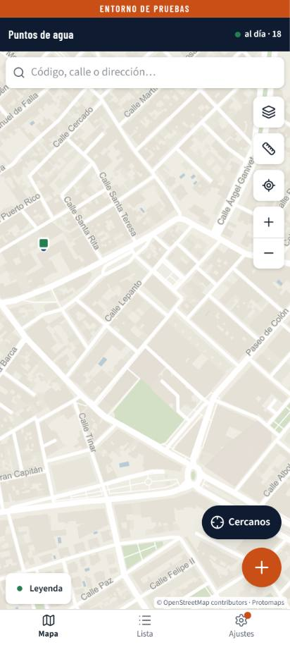</td>
<td>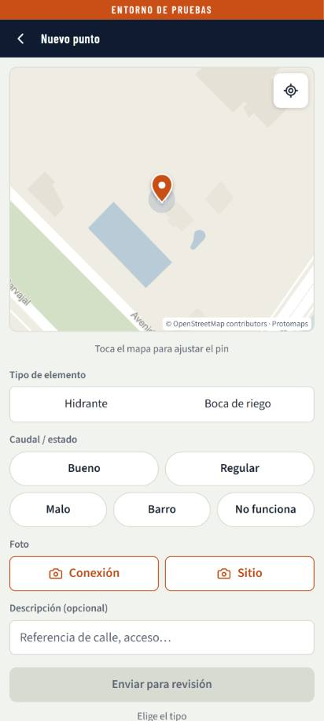</td>
<td>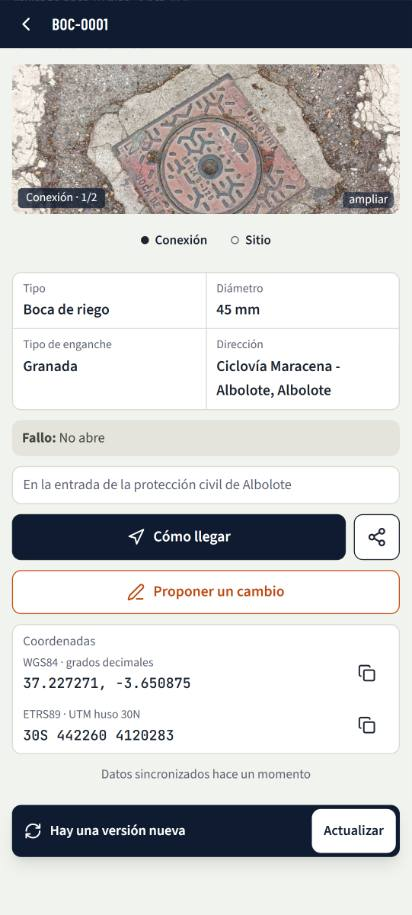</td>
<td></td>
</tr></table>

De izquierda a derecha: el mapa tras la segunda descarga; el alta con el pin a la vista cuando llega
la posición; el final de la ficha por encima del aviso de versión; el anillo de foco sobre la barra,
en oscuro.

<table><tr>
<td>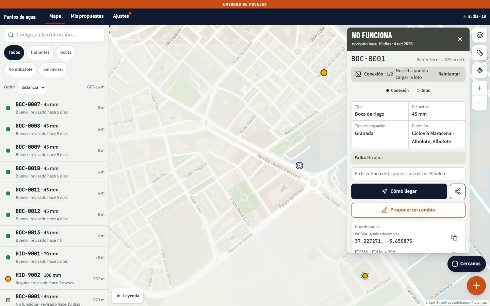</td>
<td>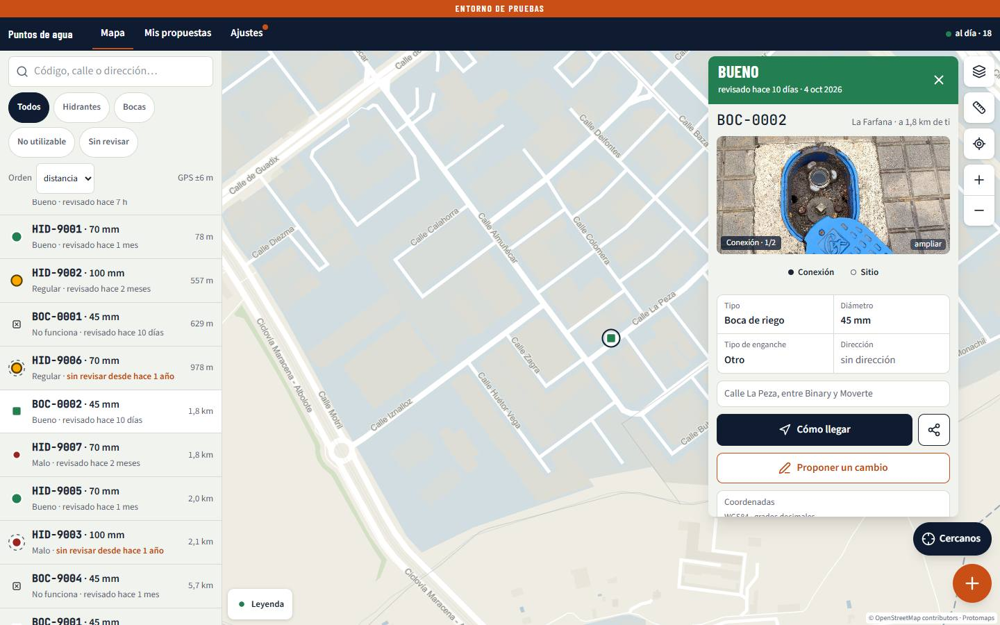</td>
<td>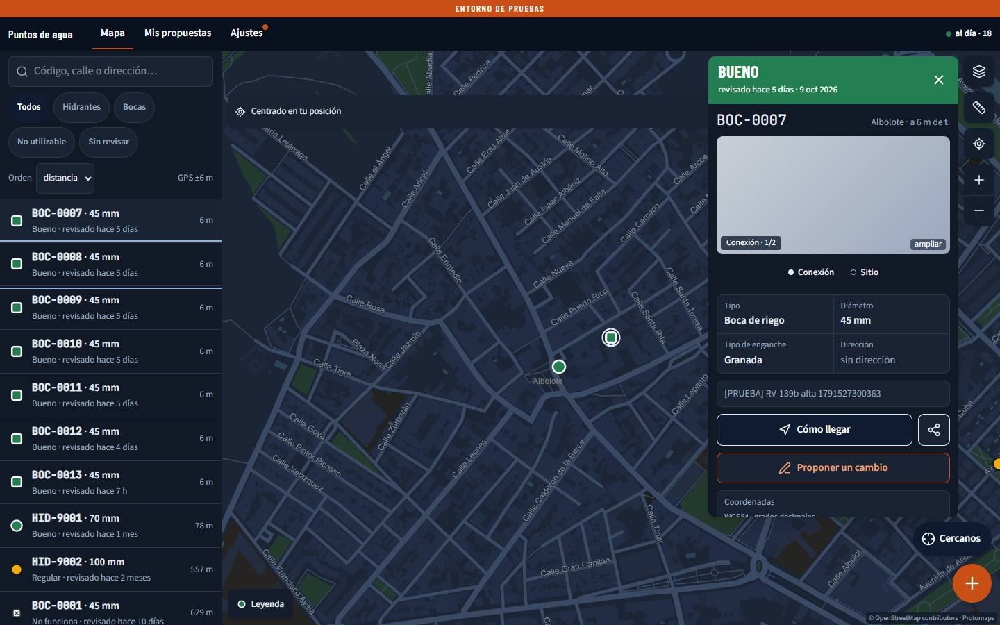</td>
</tr></table>

La foto que falla; el punto siguiente con su foto; el anillo de foco en la lista, en oscuro.

<table><tr>
<td>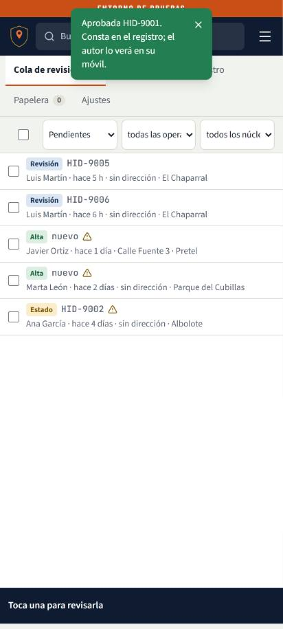</td>
<td>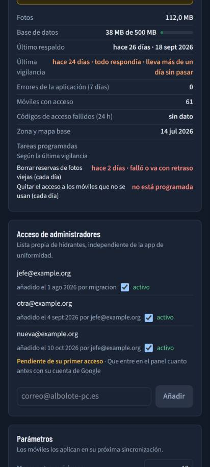</td>
<td>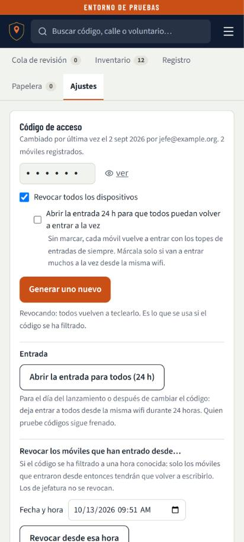</td>
<td>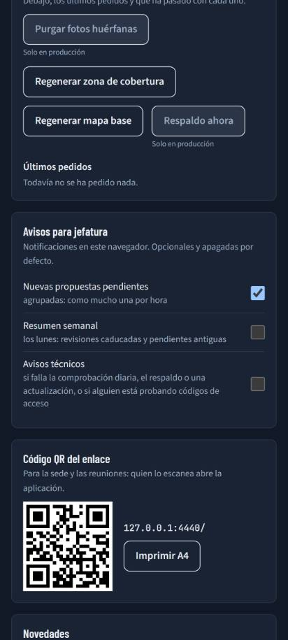</td>
</tr></table>

Panel (simulado): la Cola tras guardar habiendo pulsado ‹; administradores con uno pendiente de su
primer acceso; la casilla de abrir la entrada sin marcar; los avisos técnicos.

<table><tr>
<td>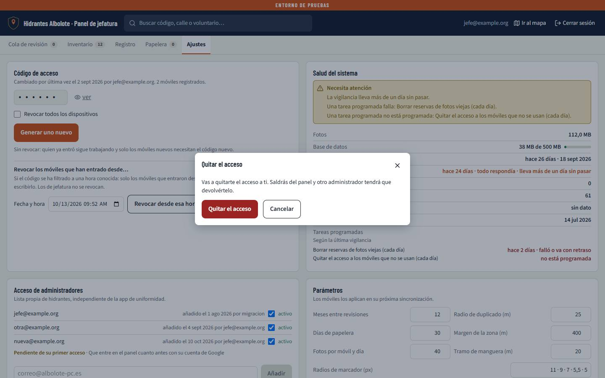</td>
<td>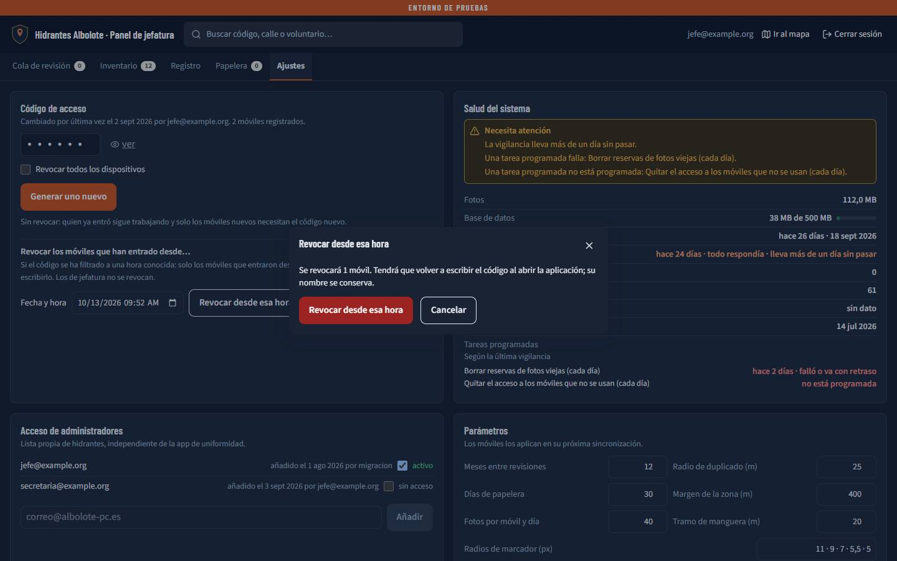</td>
</tr></table>

Quitarse el acceso a uno mismo, con su aviso; revocar desde una hora, con la cuenta.

**Notas (no son defectos):**

- Justo al pasar a un punto lejano, el fondo del mapa tarda un momento en pintarse entero; a los 2 s
  están todas las teselas (30 de 30 en los dos temas).
- El campo de fecha y hora de «Revocar desde…» sale en el formato del idioma del navegador, que en
  el de las pruebas era inglés; en un navegador en español sale en español.
